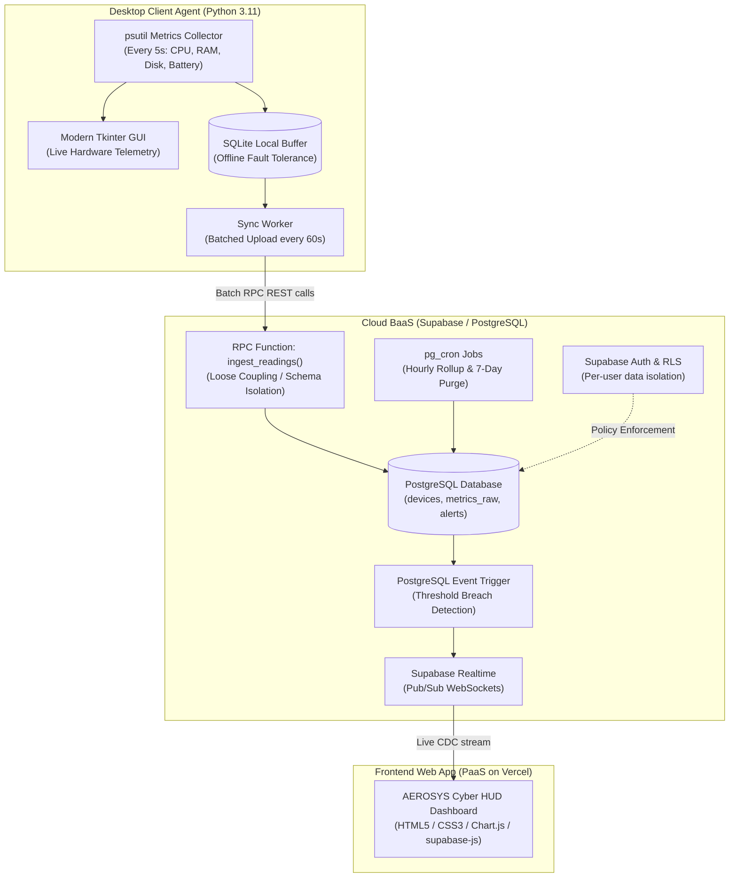

# Cloud-Based PC Health Monitoring and Performance Analysis System (AEROSYS)

> **A.Y. 2026-27 Project Synopsis Implementation**  
> **Course**: Cloud Computing / BIS505 (Semester 5, Section B)  
> **Institution**: The National Institute of Engineering, Mysore (Department of ISE)  
> **Team Members**: LIKHITHA SHREE L C (4NI24IS091), NISCHITHA R N (4NI24IS119)  
> **Project Guide**: Prof. Prajakta Madankar  

---

## 🚀 System Architecture & Cloud Concepts

The system monitors computer hardware performance and health metrics, transmitting them to a cloud-hosted backend for real-time and historical analytics.



### Cloud Computing Concepts Demonstrated:
1. **Service Models**:
   - **BaaS (Backend-as-a-Service)**: Supabase manages Auth, PostgreSQL, and WebSockets.
   - **PaaS (Platform-as-a-Service)**: Vercel for zero-config edge web dashboard hosting.
2. **Multi-Tenancy & Data Isolation**:
   - PostgreSQL **Row Level Security (RLS)** restricts telemetry visibility strictly to the authenticated user owning the machine.
3. **Loose Coupling**:
   - The desktop agent never communicates directly with internal database tables. It interfaces solely through the `ingest_readings()` RPC function.
4. **Event-Driven Processing & Real-time Pub/Sub**:
   - A database trigger checks incoming readings against thresholds (CPU > 90%, RAM > 90%, Battery < 15%) and inserts alerts pushed instantly to the web dashboard via Supabase Realtime channels.
5. **Eventual Consistency & Offline Resilience**:
   - Local SQLite buffer stores readings during internet disruptions and automatically flushes accumulated batches when connectivity is restored.
6. **Data Lifecycle Management**:
   - Automated `pg_cron` jobs aggregate raw telemetry into hourly summaries (`metrics_hourly`) and delete raw samples older than 7 days to preserve storage on the free-tier.

---

## 📁 Repository Structure

```text
pc-health-monitoring/
├── agent/                          # Python Desktop Agent
│   ├── config.py                   # Hardware identification & settings
│   ├── collector.py                # psutil system telemetry sampler
│   ├── buffer.py                   # SQLite local buffer & persistence
│   ├── sync.py                     # RPC batch transmitter to Supabase
│   ├── gui.py                      # Dark-themed Tkinter desktop monitor
│   ├── main.py                     # Thread orchestrator & entry point
│   ├── requirements.txt            # Python dependencies
│   └── .env.example                # Cloud credentials template
├── cloud/                          # Supabase Cloud Database Scripts
│   ├── 01_schema.sql               # Devices, metrics_raw, alerts, rollups
│   ├── 02_rls_policies.sql        # Row Level Security policies
│   ├── 03_ingest_function.sql     # ingest_readings() RPC definition
│   ├── 04_triggers.sql            # Threshold check triggers & Realtime
│   ├── 05_cron_jobs.sql            # pg_cron hourly rollup & 7-day retention
│   └── setup_instructions.md       # Step-by-step Supabase deployment guide
├── dashboard/                      # AEROSYS Cyber Telemetry HUD
│   ├── index.html                  # Futuristic Cyber HUD web interface
│   ├── css/style.css               # Neon sci-fi styles & glassmorphism
│   ├── js/config.js                # Local storage & alert thresholds
│   ├── js/charts.js                # Chart.js rolling & historical spline curves
│   ├── js/terminal.js              # Live telemetry event console
│   ├── js/simulator.js             # High-fidelity realistic telemetry demo
│   ├── js/supabase-client.js       # Supabase Realtime pub/sub client
│   ├── js/app.js                   # Master HUD controller
│   └── vercel.json                 # Vercel deployment configuration
├── open_dashboard.bat              # One-click browser dashboard launcher
├── run_agent.bat                   # One-click desktop agent launcher
└── README.md
```

---

## ⚡ Quick Start Guide

### 1. Launch the Futuristic Web Dashboard
Simply double-click `open_dashboard.bat` (or open `dashboard/index.html` in any modern web browser).
- The dashboard immediately launches in **DEMO SIMULATOR** mode with live animated SVG circular gauges, 60-second rolling waveforms, a cyber event console, and audio/visual threshold alert notifications.
- Click **"LIVE CLOUD"** or the **⚙ Settings** button in the top bar to connect to your live Supabase project.

### 2. Deploy Cloud Database (Supabase)
Follow the step-by-step instructions in [cloud/setup_instructions.md](cloud/setup_instructions.md) to apply the 5 SQL scripts in your Supabase SQL editor.

### 3. Run the Desktop Agent
1. Open PowerShell / Command Prompt in the project folder:
   ```bash
   cd agent
   pip install -r requirements.txt
   ```
2. Launch the desktop agent:
   ```bash
   python -m agent.main
   ```
   *(Or double-click `run_agent.bat`)*
3. Use the **⚙ Cloud Settings** button in the agent GUI to configure your Supabase URL and Key, or copy `agent/.env.example` to `agent/.env`.
